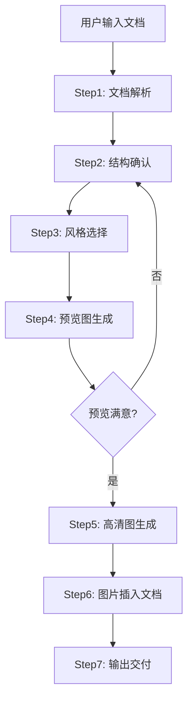

# Flow-Viz 文档流程可视化技能

将文档中的流程文字自动转换为精美的可视化流程图，并智能插入到文档对应位置。

---

## AI执行指南（必须遵守）

**重要**：本技能包含必须由AI与用户交互的环节，AI不能跳过这些步骤直接调用脚本。

### 执行检查清单

| 步骤 | 操作 | 是否需要用户交互 | AI责任 |
|------|------|------------------|--------|
| Step 1 | 调用 `parse_flow.py` 解析文档 | ❌ 否 | 自动执行 |
| Step 2 | 展示识别结果，等待用户确认 | ✅ **必须** | 展示结构 → 等待用户回复 |
| Step 3 | 提供风格选项，等待用户选择 | ✅ **必须** | 提供5种风格 → 等待用户选择 |
| Step 4 | 生成预览图，等待用户确认 | ✅ **必须** | 展示预览图 → 等待用户确认 |
| Step 5 | 调用 `flow_viz.py` 生成高清图 | ❌ 否 | 自动执行 |
| Step 6 | 调用 `insert_images.py` 插入图片 | ❌ 否 | 自动执行 |
| Step 7 | 输出交付结果 | ❌ 否 | 自动执行 |

### 典型错误（禁止）

- ❌ 解析后直接问风格，跳过结构确认
- ❌ 用户选风格后直接生成高清图，跳过预览
- ❌ 不使用技能脚本，手动实现各步骤

### 正确执行流程

```
用户上传文档
    ↓
Step 1: python scripts/parse_flow.py --file <文档> --output <json>
    ↓
Step 2: AI展示识别结果 → 用户确认/调整 ← 【等待回复】
    ↓
Step 3: AI展示风格选项 → 用户选择 ← 【等待回复】
    ↓
Step 4: python scripts/flow_viz.py --file <文档> --style <风格> --preview
        AI展示预览图 → 用户确认 ← 【等待回复】
    ↓
Step 5: python scripts/flow_viz.py --file <文档> --style <风格>
    ↓
Step 6: python scripts/insert_images.py --docx <文档> --images <图片列表>
    ↓
Step 7: 输出新文档 + 图片文件
```

---

## Quick Start

**1. 确保环境配置** → [common.md](references/common.md)（wan2.7 API配置）
**2. 提供文档** → Word(.docx) / PDF / 纯文本
**3. 等待生成** → AI自动完成解析→确认→预览→生成→插入
**4. 获取结果** → 带流程图的新文档 + 图片文件

---

## 工作流程



---

## 完整工作流详解

### Step 1: 文档解析与流程提取

**目标**：识别文档中的所有流程，提取结构信息

**处理逻辑**：
```
输入文档 → 分析文本 → 识别流程段落 → 提取步骤结构 → 标记位置
```

**提取内容**：
- 流程步骤序列
- 分支判断（条件A→路径B，条件C→路径D）
- 并行结构（同时进行）
- 循环结构（返回某步骤）
- 泳道区分（不同角色/部门）

**输出示例**：
```
已识别到 3 个流程：

流程1: 设备申请流程（位于文档第3段）
  1. 提交申请 → 2. 部门审批 → 3. 采购审核 → 4. 发放设备

流程2: 报销审批流程（位于文档第5段）
  1. 填写单据 → 2. [判断]金额>5000?
     ├─ 是 → 3a. 财务总监审批 → 4
     └─ 否 → 3b. 财务经理审批 → 4
  4. 打款 → 5. 结束

流程3: 入职办理流程（位于文档第7段）
  1. HR发offer → 2. 员工确认 → 3. 提交材料
  4. IT创建账号 ← 同时 ← 5. 行政分配工位
  6. 入职培训 → 7. 结束
```

---

### Step 2: 结构确认（用户交互）

**展示内容**：
- 已识别流程的文本结构预览
- 可编辑调整：添加/删除步骤、修改分支、调整顺序

**用户操作**：
- 确认结构正确 → 进入下一步
- 编辑调整 → AI协助修改后重新确认
- 补充遗漏流程 → AI重新扫描文档

---

### Step 3: 风格选择

提供5种预设风格：

| 编号 | 风格名称 | 特点 | 适用场景 |
|------|----------|------|----------|
| 1 | 简约商务 | 线条清晰，蓝灰色调 | 正式文档、报告 |
| 2 | 扁平图标 | 带小图标，活泼配色 | 培训材料、手册 |
| 3 | 企业专业 | 深色调，立体感 | 企业官网、PPT |
| 4 | 彩色活泼 | 多彩渐变，年轻感 | 内部文档、宣传 |
| 5 | 中国风 | 水墨风格，典雅大气 | 政府、文化机构 |

**默认配置**：
- 尺寸：横向 16:9（适合PPT/文档）
- 分辨率：预览图1K，成品图2K

---

### Step 4: 预览图生成

**使用 wan2.7 草稿模式**：
- 快速生成简化版预览图
- 重点确认：整体布局、结构正确性
- 不追求精美，快速迭代

**Prompt模板（预览）**：
```
生成一张简洁的流程示意图草稿，黑白线条风格：
- 流程结构：{解析出的结构}
- 重点：清晰展示步骤顺序和分支关系
- 不需要精美装饰，快速生成
- 横向布局，16:9比例
```

**用户确认**：
- 满意 → 批量生成所有流程的高清图
- 需调整 → 返回修改结构或换风格

---

### Step 5: 高清成品图生成

**调用 wan2.7 API**：
- 使用 `wan2.7-image` 模型
- 分辨率：2K（适合打印和展示）
- 横向 16:9 比例
- 每个流程生成 1 张独立图片

**Prompt模板（成品）**：
```
生成一张精美的流程示意图：
- 流程结构：{确认后的结构JSON}
- 风格：{用户选择的风格}
- 要求：
  * 每个步骤配有直观小图标
  * 箭头清晰，流向明确
  * 分支判断用菱形框标注
  * 配色协调统一
  * 文字清晰可读
- 尺寸：横向16:9，2K高清
- 适用场景：企业培训材料、操作手册
```

**生成逻辑**：
```python
for each flow in flows:
    prompt = build_prompt(flow, style)
    image_url = wan2.7_generate(prompt, size="1820*1024", n=1)
    download_image(image_url, f"flow_{index}.png")
```

---

### Step 6: 图片插入文档

**插入规则**：
- 定位流程标题位置
- 在标题下方插入对应流程图
- 图片居中，宽度适应页面

**支持的文档格式**：

| 格式 | 处理方式 |
|------|----------|
| Word (.docx) | 使用docx skill，直接编辑XML插入图片 |
| PDF | 先转换Word，或生成带图新PDF |
| 纯文本 | 生成新Word文档，文字+图片 |

**插入示例**：
```
原文档：
━━━━━━━━━━━━━━━━━━━━━━━
第3段：设备申请流程
员工需按照以下步骤申请设备...

【AI插入位置】
↓ 在此处插入流程图1.png
↓

第4段：其他内容...
━━━━━━━━━━━━━━━━━━━━━━━
```

---

### Step 7: 输出交付

**交付内容**：
1. **新文档**：带流程图插入的完整文档
2. **图片文件**：每个流程的独立PNG图片
3. **可选项**：调整某个流程图、换风格重新生成

---

## 脚本说明

### 📜 parse_flow.py

**用途**：解析文档，提取流程结构

**调用方式**：
```bash
python scripts/parse_flow.py --file document.docx
# 输出：JSON格式的流程结构列表
```

**输出格式**：
```json
{
  "flows": [
    {
      "id": 1,
      "title": "设备申请流程",
      "location": {"paragraph": 3, "heading": "第二章"},
      "structure": {
        "type": "linear",
        "steps": ["提交申请", "部门审批", "采购审核", "发放设备"]
      }
    },
    {
      "id": 2,
      "title": "报销审批流程",
      "location": {"paragraph": 5},
      "structure": {
        "type": "branch",
        "steps": [...]
      }
    }
  ]
}
```

---

### 📜 flow_viz.py

**用途**：主控脚本，整合全流程

**调用方式**：
```bash
python scripts/flow_viz.py \
  --file document.docx \
  --style 1 \
  --output output_dir
```

---

### 📜 insert_images.py

**用途**：将图片插入Word文档

**调用方式**：
```bash
python scripts/insert_images.py \
  --docx document.docx \
  --images flow_1.png flow_2.png \
  --locations '{"flow_1": {"paragraph": 3}, "flow_2": {"paragraph": 5}}'
```

---

## 依赖说明

**必需依赖**：
- `wan2.7-image-skill`：图像生成
- `docx`：Word文档操作
- `DASHSCOPE_API_KEY`：wan2.7 API密钥

**可选依赖**：
- `pandoc`：文档格式转换
- `pdf` skill：PDF处理

---

## 使用示例

### 示例1：Word文档处理

```
用户：帮我把这份操作手册里的流程都生成示意图
[上传 manual.docx]

AI：我识别到4个流程，结构如下：
流程1: 设备申请...
流程2: 报销审批...
流程3: 请假流程...
流程4: 入职办理...

请选择风格：
1. 简约商务  2. 扁平图标  3. 企业专业  4. 彩色活泼  5. 中国风

用户：选择简约商务风格

AI：[生成预览图]
预览图已生成，结构是否正确？

用户：正确，开始生成高清图

AI：[调用wan2.7生成4张高清图]
[插入图片到文档]

完成！已输出：
- manual_with_flows.docx（带流程图的新文档）
- flow_1.png, flow_2.png, flow_3.png, flow_4.png
```

### 示例2：纯文本处理

```
用户：帮我生成这个流程的示意图：
"新员工入职：HR发送offer → 员工确认 → 提交材料 → IT创建账号 → 
分配工位 → 入职培训 → 完成"

AI：已识别流程结构，请选择风格...

用户：扁平图标风格

AI：[生成流程图]

完成！已输出：
- 入职流程.png
- 入职流程.docx（可选生成带图的文档）
```

---

## 错误处理

| 错误 | 原因 | 解决方案 |
|------|------|----------|
| 无法识别流程 | 文档格式不规范 | 提示用户用结构化描述 |
| wan2.7生成失败 | API错误/超时 | 重试或检查API配置 |
| 图片插入失败 | 文档损坏/格式异常 | 尒试重新打开文档 |

---

## 相关文档

- 📖 [common.md](references/common.md) - wan2.7 API配置
- 📖 [workflow.md](references/workflow.md) - 详细工作流说明
- 📜 [parse_flow.py](scripts/parse_flow.py) - 流程解析脚本
- 📜 [flow_viz.py](scripts/flow_viz.py) - 主控脚本
- 📜 [insert_images.py](scripts/insert_images.py) - 图片插入脚本