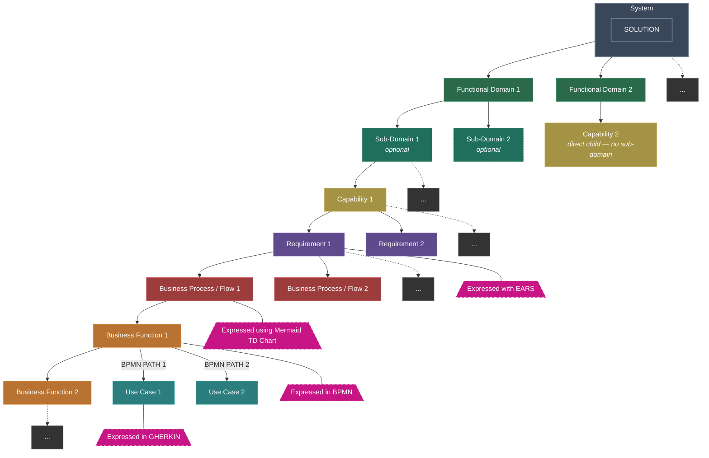

# Skill: Input Hierarchization

## Purpose

Raw specification material arrives in heterogeneous shapes — a paragraph, a swagger endpoint, a BPMN lane, a user story, a diagram callout. Before any analysis can happen, every fragment must answer two questions: **what IS it** (which layer of the tree?) and **where does it ATTACH** (which parent node?). This skill provides the canonical tree, the per-layer authoring conventions, and one protocol that answers both. Without a shared coordinate system, multi-lens analysts (functional / technical / ui-ux / quality-compliance) cannot cross-reference their findings and downstream skills (test-case-generator, coverage-checker) cannot align coverage.

Companion skill: [`ears`](../../../ears/skills/ears/SKILL.md) — the five EARS patterns and the review checklist for L5 Requirement nodes.

---

## The Tree



Each node has exactly one parent on the spine; reuse across the tree is by *reference*, not duplication. When a Business Function's BPMN has N paths (happy + alternates / errors / variants), that yields **N Use Cases** (one per path) — alternates are not bundled inside a single Use Case.

---

## Layers

| Level | Concept | What lives here | Example | Authoring convention |
|-------|---------|------------------|---------|----------------------|
| **L1** | **System (Solution)** | The top-level boundary — the product / solution. Exactly one root. | `Parking-API`, `Customer-Portal` | — |
| **L2** | **Functional Domain** | A logical grouping of business responsibilities — the *department* of the system. Stable, large-scoped, owned by a stakeholder group. | `Distribution and Sale` | — |
| **L3** | **Sub-Domain** *(optional)* | A partition inside a Domain (multiple teams / regulatory regimes / product lines / lifecycle phases). Skip when the Domain is small or coherent. | `Physical Channels`, `Digital Channels` | — |
| **L4** | **Capability** | What the system is *capable of doing* — a stable power, expressed as a noun. The *what*, not the *how*. Reusable across many Business Functions. Parent is L3 when present, else L2. | `Physical sales management` | — |
| **L5** | **Requirement** | A statement of what the system shall do or constrain, attached to a Capability. | `When the user submits…, the auth-service shall…` | **EARS** (see companion `ears` skill). Violations: `needs-EARS-rewrite`. |
| **L6** | **Business Process / Flow** | A pack of ordered Business Functions that satisfies a Requirement — the temporal dimension. | `The purchase of a ticket at the TVM` | **Mermaid TD chart**. Violations: `needs-mermaid-normalization`. |
| **L7** | **Business Function** | A user-invokable unit of behavior exercised inside a Process. Branches into BPMN paths. | `Contactless payment` | **BPMN 2.0** (lanes, gateways, events). Violations: `needs-BPMN-normalization`. |
| **L8** | **Use Case** | One BPMN path through a Business Function — one user goal, one Gherkin scenario. | `Pay with contactless card — happy path`, `… — card declined` | **Gherkin** — one `Scenario:` per Use Case (`Scenario Outline:` + Examples for data-varied paths). Violations: `needs-gherkin-rewrite`. |

**Sub-Domain decision rule.** Introduce L3 when at least one is true: the Domain spans multiple ownership groups; mixes regulatory regimes (e.g. retail vs. corporate, EU vs. US); has > ~6 Capabilities so flat listing obscures grouping; or the source explicitly names a sub-grouping. Otherwise skip — do not invent Sub-Domains for cosmetic structure. Mixed mode is fine: Domain A can have Sub-Domains while Domain B does not.

**Legacy synonyms.** Older specs use *Feature* (≈ L7 Business Function) and *Process* (≈ L6 Business Process / Flow). Preserve source wording in `name`; classify under the canonical layer.

---

## Off-Spine Concepts

The spine answers "what *is* the system and what does it *do*". Three concepts sit alongside the spine — they participate in many spine nodes but do not belong on the tree itself: **Stakeholder Goals** (what the system *should aspire to*), **Actors** (who *interacts with* the system), and **Assets** (what the system *holds, guards, or commands*). Putting any of them on the spine would force absurd single-parent choices and would duplicate the same node across every place it is referenced. Off-spine + typed references keep the model honest.

### Stakeholder Goals

A **Stakeholder Goal** is an aspirational statement *with no agreed acceptance criterion* (see the `ears` skill's goal-vs-requirement test). Goals are NOT Requirements: they are owned by stakeholders, may be unattainable, may conflict, and cannot be authored as `shall` statements. They attach to the Functional Domain or System whose vision they inform, and trace forward to the L5 Requirements they motivate.

```yaml
- id: GOAL-001
  level: goal
  name: "Make the platform feel as fast as Medium."
  parent: FD-distribution-and-sale     # owning Domain (or System)
  source: "S1 vision statement"
  traces_to: [REQ-014, REQ-022]        # the L5 Requirements this goal motivates
```

### Actors

An **Actor** is an entity *external to the System* that interacts with it — the source of triggers and/or the recipient of responses. An Actor is a **role**, not a specific person (`Customer`, not `Alice`). Three kinds:

| Kind | What it is | Example |
|---|---|---|
| `human` | A user in a named role | `Customer`, `Field-agent`, `Admin` |
| `system` | An external system integrated via API / event / file / message bus | `Stripe-payments`, `Salesforce-CRM`, `SMTP-relay` |
| `time` | A scheduler / timer that initiates timed Use Cases | `Daily-billing-cron`, `EOD-reconciliation-scheduler` |

```yaml
- id: ACT-customer
  level: actor
  kind: human
  name: Customer
  source: "S1 §3 — actors"
```

### Assets

An **Asset** is a resource of value *owned, managed, or protected* by the System. Assets are **things**, not behaviors — what the system holds, references, reads, writes, or guards. Three kinds (the latter two are progressive specializations):

| Kind | What it is | Example |
|---|---|---|
| `physical` | Hardware or a real-world object the system commands or measures | `Ticket-vending-machine`, `Turnstile`, `Receipt-printer` |
| `dataset` | A structured collection of data records with its own schema and lifecycle | `Customer-master`, `Daily-sales-transactions` |
| `golden-data` | The authoritative master version of a critical Dataset — the source of truth other systems must defer to | `Authoritative-product-catalog`, `KYC-reference-record` |

```yaml
- id: AST-customer-master
  level: asset
  kind: dataset
  name: Customer master
  parent: FD-distribution-and-sale     # owning Domain
  schema_ref: "S2 OpenAPI #/components/schemas/Customer"   # datasets only
  source: "S2 schemas"
```

### Typed references from spine nodes

Spine nodes (typically L5/L6/L7/L8) reference off-spine concepts via these typed fields. Always reference; never duplicate.

| Field | Points at | Meaning |
|---|---|---|
| `involves_actors` | Actor IDs | Roles that participate in this node (initiate triggers, receive responses, appear in BPMN swimlanes / Gherkin Given/When subjects). |
| `reads` | Asset IDs | The node consumes data from the Asset. |
| `writes` | Asset IDs | The node mutates the Asset. |
| `uses` | Asset IDs | The node depends on a physical / non-data Asset to operate. |
| `protects` | Asset IDs | The node enforces security / privacy / integrity guarantees on the Asset. |
| `depends-on-golden` | Asset IDs (golden-data only) | The node defers to a Golden-Data Asset as source of truth. |
| `traces_to` | Requirement IDs | (Goals only) the L5 Requirements this Goal motivates. |

Example:

```yaml
- id: UC-pay-contactless
  level: L8
  parent: BF-payment
  source: "S1 AC-12"
  involves_actors:    [ACT-customer, ACT-payment-gateway]
  reads:              [AST-product-catalog, AST-customer-master]
  writes:             [AST-customer-master]
  uses:               [AST-tvm]
  protects:           [AST-customer-master]
  depends-on-golden:  [AST-product-catalog]
```

---

## Disambiguation

When a fragment looks like it could be two things, apply these tests:

- **Capability vs. Business Function** — *what the system can do* (Capability — `physical sales management`) vs. *the user-invokable service exercising it* (Business Function — `buy a ticket with contactless card`). Capabilities are reusable across many Business Functions.
- **Business Function vs. Business Process** — a user-invokable unit with internal branching (L7) vs. a cross-domain orchestration of multiple Business Functions (L6). A Business Function appears inside a Process step.
- **Use Case vs. Business Function** — a Use Case is one BPMN path through a Business Function (one user goal, one Gherkin scenario). The Business Function holds the branching; the paths through it are Use Cases.
- **Actor vs. System** — if the fragment is *under analysis* (something this spec describes the behavior of), it's the L1 System or a spine node within it. If it *interacts with the system from outside* (initiates calls, receives responses, runs on its own clock), it's an Actor.
- **Asset vs. Capability** — Capabilities are *behaviors* (verbs the system can perform); Assets are *things* (nouns the system holds or guards). `Pricing management` is a Capability; `Pricing-referential` is an Asset.
- **Asset kinds (physical → dataset → golden-data)** — non-data resource → `physical`. Structured records with their own schema → `dataset`. The authoritative master copy → `golden-data` (a specialization of dataset).

---

## Protocol

The same protocol covers both single-fragment classification and corpus-wide organization. Walk the tree top-down, stop at the first match per fragment, and validate at the end.

1. **System (L1).** One root for the product / solution. Reconcile naming with the user.
2. **Functional Domain (L2).** Top-level grouping / department. Reconcile synonyms before going further — Domain names propagate everywhere.
3. **Sub-Domain (L3).** Apply the Sub-Domain decision rule. If it qualifies, place L3 nodes; otherwise skip. Per-Domain decision (mixed mode allowed across the System).
4. **Capability (L4).** A noun describing a system power. Parent is L3 when present, else L2.
5. **Requirement (L5).** A "shall" / "when … shall …" statement. EARS-validation runs in the EARS Compliance Gate (downstream); this protocol places the node, the gate validates the wording.
6. **Business Process / Flow (L6).** A top-down ordered sequence satisfying a Requirement. Author or normalize to Mermaid TD.
7. **Business Function (L7).** A user-invokable unit of behavior with internal branching (gateways, paths). Author or normalize to BPMN.
8. **Use Case (L8).** One BPMN path through a Business Function. Author the Gherkin scenario for each path — N paths → N Use Cases.

After placement (corpus mode):

9. **Validate.** Every leaf has a parent. No orphans, no cycles. Each node carries `source`.
10. **Surface gaps.** A Capability without Requirements; a Requirement without a Process; a Process without Business Functions; a Business Function without Use Cases; a Use Case without a Gherkin scenario. Gaps are deliverables, not failures — report, don't drop.

If a fragment matches no layer, tag it `unclassified` and surface it. Never invent a node. Never silently merge two Domains with similar names — reconcile with the user.

---

## Output Conventions

Every classified node is emitted in this canonical YAML so downstream consumers parse it uniformly:

```yaml
- id: <stable-slug>                            # e.g. SYS-pdc, FD-payments, CAP-checkout, REQ-001, UC-signup-happy, ACT-customer, AST-tvm
  level: L1 | L2 | L3 | L4 | L5 | L6 | L7 | L8 | goal | actor | asset | unclassified
  name: <human-readable, source-language preserved>
  parent: <id of parent>                       # null for L1; L4 parent is L3 when present, else L2; off-spine nodes attach to a Domain or System
  source: <verbatim quote or doc-anchor>       # MANDATORY — every node traces to source
  convention-flags:                            # optional — the canonical violated-convention flag for this layer
    - needs-EARS-rewrite                       # L5 only — set by the EARS Compliance Gate
    - needs-mermaid-normalization              # L6 only
    - needs-BPMN-normalization                 # L7 only
    - needs-gherkin-rewrite                    # L8 only
  # L5 Requirement nodes — pipeline-added by the EARS gate; absent until the gate runs:
  pattern: ubiquitous | state-driven | event-driven | optional-feature | unwanted-behaviour | complex | indeterminate
  ears_conformant: yes | no
  flags: [missing-trigger, passive-voice, generic-system-name, multiple-triggers, precondition-in-prose]
  # off-spine nodes — sub-type for actor / asset:
  kind: human | system | time                  # actor only
  kind: physical | dataset | golden-data       # asset only
  schema_ref: <doc-anchor>                     # asset of kind dataset/golden-data only
  # spine-node references to off-spine concepts (typed; always reference, never duplicate):
  involves_actors:    [<ACT-id>, ...]          # roles participating in this node
  reads:              [<AST-id>, ...]          # assets consumed
  writes:             [<AST-id>, ...]          # assets mutated
  uses:               [<AST-id>, ...]          # physical / non-data assets the node depends on
  protects:           [<AST-id>, ...]          # assets the node guards (security / privacy / integrity)
  depends-on-golden:  [<AST-id>, ...]          # golden-data assets used as source of truth
  traces_to:          [<REQ-id>, ...]          # goal nodes only — Requirements the goal motivates
```

`flags` is the L5 EARS-diagnostic extension. The canonical convention violation (`needs-EARS-rewrite`) lives in `convention-flags`, NOT in `flags`. Goals, Actors, and Assets never carry `convention-flags`, `flags`, `pattern`, or `ears_conformant`. Tools reading `hierarchy.yaml` must tolerate pipeline-added and off-spine reference fields being absent (e.g. on in-progress runs, or when the spec doesn't specify Actors / Assets).

Fragments that match no layer go to a separate top-level block:

```yaml
unclassified:
  - source: <verbatim quote or doc-anchor>
    reason: <why no level matches>
```

---

## Anti-patterns

- ❌ **Inventing a node to make an orphan fit.** Use `unclassified` and surface it. This applies at every level — Domain, Sub-Domain, Capability, Requirement, all the same rule.
- ❌ **Promoting a Use Case to a Business Function because it is long.** Length is not a level signal — branching is.
- ❌ **Shoehorning a stakeholder goal into a `shall` statement.** Goals belong off-spine; demote and trace via `traces_to:`.
