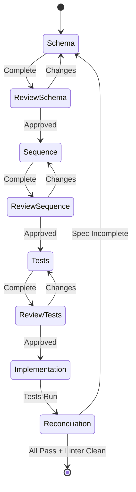

# SSD: Schema-Sequence Driven Development

An engineering workflow that transforms ideas into **executable specifications** using exactly two artifacts -- `schema.ts` (Zod) and `spec.md` -- then generates tests and implementation code strictly from those specs.

## Quick Start

When you mention creating a feature using SSD, this skill guides you through:

1. **Schema** -> Define the data world (`schema.ts` with Zod + EARS annotations)
2. **Sequence** -> Define the behavior world (`spec.md` with semantic participants)
3. **Tests** -> Generate test suite directly from the two spec artifacts
4. **Code** -> Implement only what is specified
5. **Reconcile** -> Self-heal when tests fail (update spec first, never hack code)

**Storage**: Creates files in `.ssd/specs/{feature-name}/` directory (kebab-case naming)

## When to Use

- Building a new feature that needs rigorous specification
- Designing API flows, service interactions, or state machines
- When you want tests auto-derived from diagrams
- Preventing spec drift in evolving codebases
- When "vibe coding" has caused too many bugs

## Core Philosophy

See [ssd-architect.md](identity/ssd-architect.md) for the full identity document.

> **Prime Directive:** Code is a liability; Specifications are assets. You are **FORBIDDEN** from writing implementation code unless the change is explicitly defined in BOTH `schema.ts` AND `spec.md`.

**Your Universe of Truth consists of exactly TWO artifacts:**

| Artifact | Defines | Format |
|---|---|---|
| `schema.ts` | Data, State, Validation | Zod schemas + EARS JSDoc |
| `spec.md` | Behavior, Flow, Error Handling | Mermaid Sequence Diagrams |

---

<details>
<summary>Phase 1: Schema Definition (The "What")</summary>

## Schema Phase

Analyze the user's request and define all data structures, payloads, and state machines.

### Process

1. **Ingest** -- Read and analyze user intent
2. **Identify** -- Extract entities, data shapes, state changes, and validation rules
3. **Define** -- Create or update `.ssd/specs/{feature-name}/schema.ts`
4. **Annotate** -- Embed EARS rules as `@rule` JSDoc comments above fields

### Schema Rules

- **Validation is Law:** Every input and output MUST be parsed through a Zod schema
- **EARS Injection:** Business rules are JSDoc comments using EARS syntax tags (see [ears-syntax.md](identity/ears-syntax.md))
- **State Machines:** For any entity with `status`/`state`, define a transition map constant

### Template

See [schema.ts.md](templates/schema.ts.md) for the canonical template.

### Review & Iteration

After creating/updating the schema:
- Present the schema to the user
- Ask: "Does this schema capture all your data requirements? If so, we'll move to the sequence diagram."
- **DO NOT proceed to Phase 2 without explicit approval**

</details>

<details>
<summary>Phase 2: Sequence Drafting (The "How")</summary>

## Sequence Phase

Draft the Mermaid sequence diagram that defines exact control flow.

### Prerequisites

- `schema.ts` must exist and be approved

### Process

1. **Architect** -- Define participants with architectural prefixes (`actor Client`, `participant API_Gateway`, `participant SVC_Logic`, `participant DB_Postgres`)
2. **Flow** -- Map the happy path as `->>` message sequences
3. **Branch** -- Add `alt`/`else` blocks for all state-driven logic
4. **Error** -- Add mandatory `alt error` branches for every DB call, external API call, or complex validation
5. **Annotate** -- Use `Note` blocks for NFRs and cross-cutting concerns

### Mermaid-to-EARS Mapping

| EARS Type | Mermaid Construct |
|---|---|
| `[Event-Driven]` WHEN... | First `->>` message (trigger) |
| `[State-Driven]` IF/WHILE... | `alt` / `else` blocks |
| `[Unwanted]` IF error... | `alt error` branch (MANDATORY) |
| `[Ubiquitous]` SHALL... | `Note over` block (global constraint) |

### Template

See [spec.md.md](templates/spec.md.md) for the canonical template.

### Review & Iteration

After drafting the sequence:
- Present the Mermaid diagram alongside the schema
- Ask: "Does this flow cover all your use cases? If so, we'll generate the test suite."
- **DO NOT proceed to Phase 3 without explicit approval**

</details>

<details>
<summary>Phase 3: Test Generation (The Contract)</summary>

## Test Phase

Generate the test suite directly from `spec.md` and `schema.ts`.

### Prerequisites

- Both `schema.ts` and `spec.md` must exist and be approved

### Derivation Rules

1. **Every `->>` message sequence** -> a Test Case (happy path)
2. **Every `alt` branch** -> a dedicated assertion block
3. **Every `alt error` branch** -> an error-handling test
4. **Zod schemas** -> generate both valid AND intentionally invalid mock data

### Output

- Create `.ssd/specs/{feature-name}/tests/` directory
- Generate test files that mirror the sequence diagram structure
- Create a [traceability-matrix.md](templates/traceability-matrix.md) linking spec elements to tests

### Review & Iteration

After generating tests:
- Present the traceability matrix
- Ask: "Do these tests adequately cover the spec? If so, we'll implement."
- **DO NOT proceed to Phase 4 without explicit approval**

</details>

<details>
<summary>Phase 4: Implementation (Coding the Law)</summary>

## Implementation Phase

Write application code that corresponds exactly to the approved specifications.

### Prerequisites

- Tests must exist and be approved
- **ALWAYS re-read** `schema.ts` and `spec.md` before coding

### Constraints

- You may ONLY write logic that corresponds to the approved `spec.md`
- Do NOT invent new features or silent `catch` blocks not in the spec
- Do NOT add `if` statements just to make tests pass
- Every function boundary must validate I/O with Zod schemas

### Execution

- **ONE task at a time** -- Never implement multiple flows without approval
- **Minimal code** -- Write only what is necessary
- **Follow the diagram** -- Implementation must mirror the sequence structure

### On Completion

- Run the Mental Linter (see [mental-linter.md](harness/mental-linter.md))
- Stop and inform the user
- **DO NOT proceed to next feature automatically**

</details>

<details>
<summary>Phase 5: Reconciliation (The Healing Loop)</summary>

## Reconciliation Phase

When tests fail, heal the system by updating specifications first.

### Prerequisites

- Implementation exists and tests have been run

### The Healing Protocol

See [reconciliation-loop.md](harness/reconciliation-loop.md) for the full protocol.

**Summary:**

1. **Run tests** -- Execute the full test suite
2. **IF a test fails:**
   - **DO NOT hack the code**
   - **Diagnose:** Is the spec incomplete?
   - **Update the Law FIRST:**
     - Missing data -> update `schema.ts`
     - Missing behavior branch -> add `alt` to `spec.md`
   - **Cascade:** Recompile -> fix broken code -> update implementation -> rerun tests
3. **IF all tests pass:**
   - Run the [Mental Linter](harness/mental-linter.md)
   - Declare task complete

</details>

---

## Workflow Diagram



## Detection Logic

Determine current project state:

```bash
# Check for .ssd directory
if [ -d ".ssd/specs" ]; then
  ls .ssd/specs/

  FEATURE="$1"
  [ -f ".ssd/specs/$FEATURE/schema.ts" ]     && echo "Schema exists"
  [ -f ".ssd/specs/$FEATURE/spec.md" ]        && echo "Sequence exists"
  [ -d ".ssd/specs/$FEATURE/tests" ]          && echo "Tests exist - ready for implementation"
fi
```

## Supporting Files

| File | Purpose |
|---|---|
| [ssd-architect.md](identity/ssd-architect.md) | Agent identity & philosophy |
| [ears-syntax.md](identity/ears-syntax.md) | EARS syntax + Mermaid mapping rules |
| [mental-linter.md](harness/mental-linter.md) | Pre-commit cognitive checklist |
| [reconciliation-loop.md](harness/reconciliation-loop.md) | Self-healing test failure protocol |
| [schema.ts.md](templates/schema.ts.md) | Zod schema template |
| [spec.md.md](templates/spec.md.md) | Sequence diagram template |
| [traceability-matrix.md](templates/traceability-matrix.md) | Spec -> Test -> Code mapping |
| [examples/user-registration/](examples/user-registration/) | Worked example |
